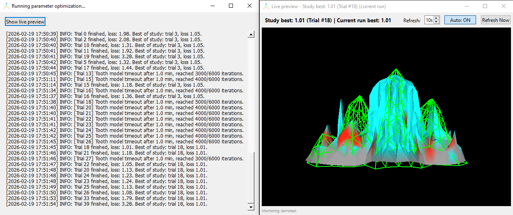
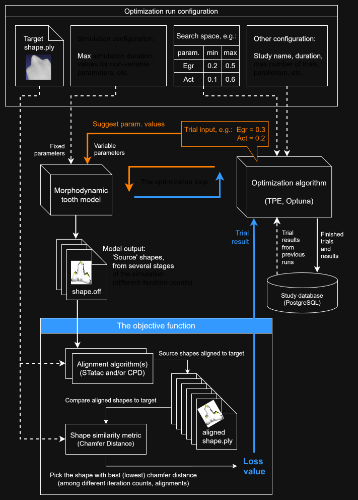

# BITES - Bayesian Inference for Tooth Emergence Simulation

[](https://www.gnu.org/licenses/gpl-3.0)
[](https://www.python.org/downloads/)




BITES is a scientific software application developed in the [Di-Poï Lab](https://www.helsinki.fi/en/researchgroups/vertebrate-evolution-development-and-regeneration) (University of Helsinki) in 2026 for exploring and optimizing vertebrate tooth morphologies in computational simulations. The program interfaces with the morphodynamic tooth development model originally proposed by Salazar-Ciudad and Jernvall [^1] and provides tools for automatically identifying parameter combinations that generate specific tooth shapes. Given a target morphology (e.g., a 3D scan of a real tooth), BITES searches the model’s parameter space for cellular and developmental parameter sets capable of producing comparable structures. Instead of manually testing thousands of parameter combinations, BITES uses Bayesian optimization via the [Optuna](https://optuna.org/) framework to intelligently search for the best parameter configurations. 

The software is described and applied to lizard dentitions in Razmadze et al., 2026 (doi: xxxx).
See the [User's Guide](assets/BITES_users_guide.pdf) for instructions on how to install and use BITES effectively.


## Why BITES?

Developmental models are typically used in a forward exploratory manner. BITES enables inverse inference of developmental parameter landscapes from empirical 3D organ morphology, bridging morphogenesis and evolutionary inference.

## Key features

- Inverse Bayesian optimization of morphodynamic model parameters
- Automated alignment (STatac + CPD)
- Chamfer Distance–based 3D shape comparison
- Multi-stage simulation evaluation
- Parallel optimization support via PostgreSQL
- GUI-based configuration and visualization



## How it works in a nutshell

1. **Optuna** optimizer proposes a set of tooth model parameters (e.g. growth rates, signaling molecule diffusion coefficients)
2. The **tooth model** morphodynamic simulation runs with those parameters, producing simulated tooth shape(s)
3. The simulated shapes are compared to the target shape
4. The resulting **loss score** (shape similarity) is fed back to the optimizer
5. Repeat for hundreds or thousands of trials to find the best parameter configurations

## Installation

Currently supported platforms: Windows

Express installation guide below. For more detailed instructions, see the [User's Guide](assets/BITES_users_guide.pdf).

### Standalone executable (Windows)

A pre-built Windows executable is available from the [Releases](https://github.com/jupander/BITES/releases) page:

1. Download and extract the zip file
2. Run `BITES.exe` from the extracted folder

### Setting up PostgreSQL (recommended)

PostgreSQL is needed for parallel optimization (running multiple trials at once). 

1. Download the PostgreSQL installer for Windows from https://www.postgresql.org/download/windows/
2. Run the installer. Use the default settings (port 5432, superuser `postgres`), but **deselect Stack Builder** in the component selection step
3. Choose a password during setup — you will need it when configuring BITES
4. In BITES, go to the PostgreSQL configuration and enter your credentials (see [User's Guide](assets/BITES_users_guide.pdf))


## Citation

If you use this software in academic work, please cite: 

```
Razmadze, D., Ikola, J., Aalto, I.M. & Di-Poï, N. 2026.
An ancestral tooth-shape patterning mechanism revealed by squamate cusp development.
bioRxiv doi: xxx
```


## License

This project is licensed under the GNU General Public License v3.0 — see the [LICENSE](LICENSE) file for details.

Third-party library licenses are listed in [THIRD_PARTY_LICENSES](THIRD_PARTY_LICENSES).


## References

The morphodynamic tooth model used by BITES is by Salazar-Ciudad and Jernvall [^1], with the model executable derived from [ToothMaker](https://github.com/jernvall-lab/ToothMaker). Parameter optimization is performed using the Optuna framework [^2]. Shape comparison uses Chamfer Distance as implemented in [point-cloud-utils](https://github.com/fwilliams/point-cloud-utils) [^3] and the Coherent Point Drift algorithm [^4] as implemented in [^5].

[^1]: Salazar-Ciudad, I., Jernvall, J., 2010. A computational model of teeth and the developmental origins of morphological variation. *Nature*, 464, 583–586. [doi:10.1038/nature08838](https://doi.org/10.1038/nature08838)
[^2]: Akiba, T., Sano, S., Yanase, T., Ohta, T., Koyama, M., 2019. Optuna: A next-generation hyperparameter optimization framework. *Proceedings of the 25th ACM SIGKDD International Conference on Knowledge Discovery & Data Mining*, 2623–2631. [doi:10.1145/3292500.3330701](https://doi.org/10.1145/3292500.3330701)
[^3]: Williams, F., 2022. point-cloud-utils (v0.34). [github.com/fwilliams/point-cloud-utils](https://github.com/fwilliams/point-cloud-utils)
[^4]: Myronenko, A., Song, X., 2010. Point set registration: Coherent point drift. *IEEE Transactions on Pattern Analysis and Machine Intelligence*, 32(12), 2262–2275. [doi:10.1109/TPAMI.2010.46](https://doi.org/10.1109/TPAMI.2010.46)
[^5]: Gatti, A. A., Khallaghi, S., 2022. PyCPD: Pure NumPy implementation of the coherent PointDrift algorithm. *Journal of Open Source Software*, 7(80), 4681. [doi:10.21105/joss.04681](https://doi.org/10.21105/joss.04681)
